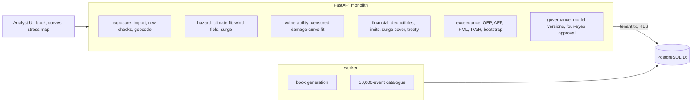

# Autonomous Insurance Catastrophe Modeling

For a property insurer on a hurricane coast. It fits a hurricane climate to forty years of best tracks and a wind damage curve to
fifteen years of claims, runs 50,000 simulated landfalls through a book of 10,000 locations with the policy terms and the reinsurance
treaty, and publishes exceedance curves, probable maximum loss with its sampling interval, a deterministic Category 4 stress test and a
four-eyes sign-off. Every number is set against the climate and damage curves the history really came from.

Built from blueprint 11 of "Advanced Engineering Build Book, Volume IV" as a **vertical slice**: the demo scenario end to end, with the
platform parts real and the rest listed under [Not built](#not-built-and-why).

**The coast, the book, the storms, the claims and the true hurricane climate are generated by a simulator in this repository: nothing is
a real insurer, a real coastline or real hurricane data. The models never see the truth; it is shown only to judge them.**

## Run it

```bash
docker compose up --build        # migrates, seeds, serves http://localhost:8330/ui/ with one worker
docker compose run --rm test     # 10 tests against a throwaway database (about 75 s)
```

Open http://localhost:8330/ui/ and press **Run all steps** (about a minute), or `make bootstrap demo`.
Demo tokens (local only): `coastal-chief_risk_officer-demo`, `coastal-analyst-demo`, `coastal-viewer-demo`. Run `make reset` before a second demo run.

## The demo, step by step

1. An invented insurer's book on 600 km of coast: 10,000 homes and small businesses in eight towns, $12.75B insured. 16% of locations
   have only a postal code and are placed at the zone's centroid. Homeowners carry 2% or 5% hurricane deductibles and no surge cover;
   about 60% of commercial policies buy surge. A second file of five rows: two accepted (one rooftop, one postal centroid), three refused
   one by one (unknown construction, deductible not below the building value, coordinates offshore).
2. Forty years of best tracks: 14 landfalls, a rate of 0.35 a year (90% interval 0.21–0.55; the truth is 0.45). Two Category 4s in forty
   years make the fitted climate expect one every 12 landfalls (8.5%); the truth is one in 50 (2.0%). Fifteen years of claims: 554 claims
   from 6,987 policies in seven storms' footprints; the rest stayed under the deductible. The censored fit says a 45 m/s gust does 1.7%
   damage to a wood-frame house (truth 1.8%); a fit to the claims alone says 10.2%. At 75 m/s the censored fit reads 32% against 48%.
3. 50,000 landfalls from the fitted climate, 144,118 simulated years, 32 s on one core. Average annual loss $9.2M (truth $8.9M; burn cost of
   the forty observed storms on today's book $9.6M). 100-year PML $157M (sampling interval $154M–$160M; truth $154M), 250-year $227M (truth
   $231M). The $160M xs $40M treaty attaches 6.8% of years and exhausts 0.55%. The page says why this coast lands so close: the climate's
   Category 4s are four times too frequent and the damage curve reads strong winds a third low, and the two cancel.
4. A Category 4 (60 m/s, 22 km radius of maximum wind) lands on Port Ellis, the town with the most insured value: expected loss $299M (80%
   of draws $281M–$316M), $139M net of an exhausted treaty, about a 1-in-616-year occurrence on the curve. Through the true damage curves at
   the true coordinates the same storm costs $440M: the model is 32% low here, because of the curve. Homeowners' excluded surge is $51M of
   damage nobody insured. Landing 10 km west is worse ($312M): the town is then on the strong right side of the track.
5. The analyst who ran the catalogue tries to approve it and is refused (four eyes); the chief risk officer approves it, and it becomes
   the published view of risk. Hash-chained audit log.

## Architecture



| Piece | How it works |
|---|---|
| Simulator (`ct/world.py`) | A straight 600 km coast, eight towns, 10,000 locations with construction, year, roof, stories, elevation and policy terms. True climate: Poisson landfalls (0.45 a year), a truncated Weibull pressure deficit, radius of maximum wind falling with intensity, lognormal forward speed, heading north ±25°, landfall density tilted along the coast. Wind: a modified Rankine vortex with the forward speed added on the right of track, Kaplan–DeMaria decay inland, gust factor. Surge: on the right of the track, near the coast, by elevation. True damage: a lognormal-CDF curve per construction class, a Beta draw around it. Forty years of best tracks with measurement noise; fifteen years of claims for every policy in every footprint, with damage under the deductible never reported. |
| Hazard fit | Maximum likelihood on the forty years: Poisson rate with its interval, Weibull on the pressure deficits, regressions for the radius and the speed, landfall density along the coast. A bootstrap gives the interval on P(Category 4+). |
| Vulnerability fit | The wind at each claim is rebuilt from the observed best track. Censored Beta likelihood: a reported claim contributes its density, a policy in the footprint that never claimed contributes the probability its damage stayed under the deductible (`scipy.special.betainc`). The naive fit for comparison: least squares on the reported claims only. |
| Catalogue | Events from the fitted climate; for each, the locations inside the track window (out to where the gust falls under 26 m/s) whose expected damage is above 1 in 100,000; mean damage from the fitted curve, a Beta draw with secondary uncertainty, deductible, limit, surge only where covered; the treaty per occurrence. Vectorised in chunks of 500 events, float32. |
| Exceedance | Occurrence and aggregate curves, gross and net; PML at 2 to 1,000 years; a bootstrap of whole simulated years gives a 90% sampling interval; TVaR; the burn cost of the forty observed storms on today's book as the actuarial baseline. |
| Stress test | One storm, 200 draws of the damage scatter: expected loss as the mean over draws (with deductibles, the loss at the mean damage would understate it), the treaty, the return period of that loss on the occurrence curve, a 4 × 2 km damage map, the same storm 10–40 km east and west, and the truth through the true curves and coordinates. |
| Platform | Row-level security per insurer, Postgres job queue, Idempotency-Key replay, hash-chained audit log, versioned model artifacts, `/metrics`. |

## Data model

`migrations/002_cat.sql` follows the blueprint (portfolio, location, building, policy, coverage, model_artifact, scenario_run,
hazard_event, loss_sample, ep_curve); additions are marked `(+)`: the book's seed, the policy's location, the model's parameters, run
approval, and `damage_sample` for the stress test's per-location losses.

## API

| Method | Endpoint | Purpose |
|---|---|---|
| POST | `/v1/portfolios/import` | `generate`: 202 + job, the synthetic book; `rows`: 201, each row checked and geocoded on its own |
| GET | `/v1/portfolios/{id}` | (+) The book by town, construction, geocode precision, policy terms |
| POST | `/v1/models/calibrate` | (+) Climate from best tracks, damage curve from claims; stored as versioned models |
| POST | `/v1/scenarios/run` | 202 + job: the stochastic catalogue through the book |
| GET | `/v1/scenarios/{id}/losses` | Largest events, AAL by category, town, construction, geocode |
| GET | `/v1/portfolios/{id}/ep-curve` | OEP/AEP gross and net, PML with interval, TVaR, AAL, the treaty, burn cost |
| POST | `/v1/scenarios/{id}/approve` | (+) Four-eyes sign-off by a chief risk officer |
| POST | `/v1/stress-tests` | A deterministic storm through the book |

Contract: [`docs/openapi.json`](docs/openapi.json).

## Measured

[`docs/evaluation.md`](docs/evaluation.md) (`python -m ct.evaluate`, three coasts the demo never uses) and
[`docs/performance.md`](docs/performance.md).

| Component | Result on three unseen coasts | Baseline |
|---|---|---|
| Average annual loss | 14–41% low | burn cost of the forty observed storms 43–59% low; naive damage curve 206–781% high |
| 100-year PML | 12–25% low | naive damage curve 102–190% high |
| 250-year PML | 9–16% low | naive damage curve 86–139% high |
| Damage curve from claims, wood frame at 75 m/s | 0.47–0.49 (truth 0.48) | |
| Light damage at 45 m/s | | naive fit 0.10–0.12 (truth 0.018) |
| P(Category 4+) per landfall from forty years | 0.004–0.017 (truth 0.020) | |
| Postal-centroid geocoding alone | 3–7% low on AAL | |
| Catalogue sampling error, 250-year PML at 30,000 events | ±3.0–4.4% | |
| Category 4 at the largest town | −6% to +18% (the demo coast: −32%) | |

Three things these numbers say plainly. The model is low on every unseen coast, because forty years of history rarely contain enough
Category 4s and the fit says the tail is lighter than it is; a bigger catalogue does nothing about that. The censored fit is the part
that works: ignoring the policies that never claimed overstates light damage six-fold and the whole loss several times. And the burn
cost, the actuary's check, is worse than the model, by about the same reasoning: forty years are forty years.

## The hardest tradeoff

What to show next to the answer. A catastrophe model's output is one curve, and on the demo coast it lands within a few percent of the
truth. That closeness is luck: the climate fitted to forty years has Category 4s four times too often, the damage curve fitted to the
claims reads strong winds a third low, and the errors cancel. A page that showed only the curve would be claiming a precision the
inputs cannot support. So every step carries the truth beside the fit, the evaluation changes one ingredient at a time on coasts the
demo never sees, and the page puts the catalogue's sampling interval (±2%) next to the error from having only forty years (tens of
percent), because the second is the one a bigger computer cannot fix.

## Threat model (summary)

| Threat | Mitigation here | Gap |
|---|---|---|
| A bad exposure row moving the PML | Unknown construction, impossible deductibles and offshore coordinates refused row by row; geocode precision kept and reported | No address validation against a real geocoder |
| One person publishing their own numbers | The run's author cannot approve it; only a chief risk officer can; approval marks the models used | No model-change committee workflow |
| A model silently changed | Every fit stored as a versioned artifact with its parameters and metrics; runs reference them | Artifacts live in the database, not a model registry |
| One insurer seeing another's book | Row-level security on every table; tested through the API and directly in the database | |

## Not built, and why

- **Real hazard data (HURDAT2, NOAA surge), real exposure, real claims**: generated instead, so every fit can be scored against the truth.
- **A real coastline, terrain roughness, storm tracks that curve or run along the coast**: a straight coast and straight tracks keep the physics checkable.
- **Flood, earthquake, wildfire perils; demand surge; post-event loss amplification**: one peril done end to end.
- **Aggregate treaties, quota share, reinstatements, a reinsurance programme optimiser**: one per-occurrence excess-of-loss layer.
- **The blueprint's 100,000-location throughput target**: measured at 10,000 locations only (see performance).
- **Kafka, Redis, OpenTelemetry, a model registry, Terraform, CI, SSO, a Next.js front end**: not needed to prove the slice; no cloud account used.

## Commercial sketch

Buyer: insurers, reinsurers, lenders, asset managers. Pricing shape from the blueprint: portfolio size plus peril modules plus compute
credits, with an enterprise tier for SSO, audit export and private deployment.

## Layout

```
core/        platform kit: db + RLS, jobs, audit chain, HTTP, scenario runner, load test
ct/          world (coast, book, climate, wind, surge, damage, history), engine (fits, catalogue, exceedance, stress), api, seed, evaluate
migrations/  forward-only SQL          web/   UI, scenario.json, demo.json (recorded run)
tests/       10 tests                  docs/  evaluation.md, performance.md, openapi.json
```
